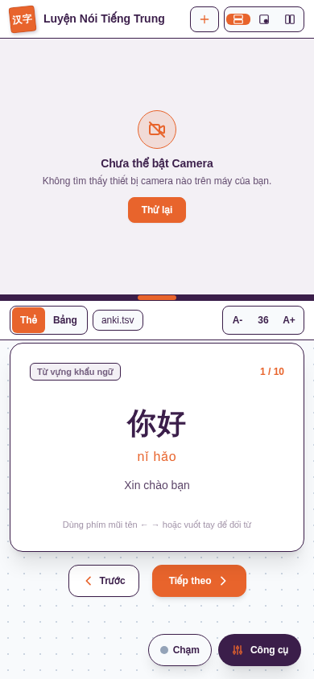
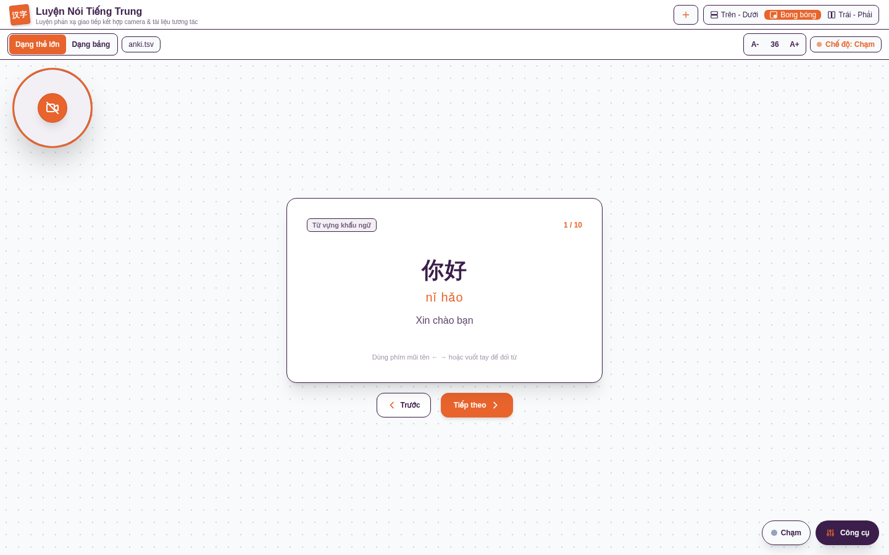
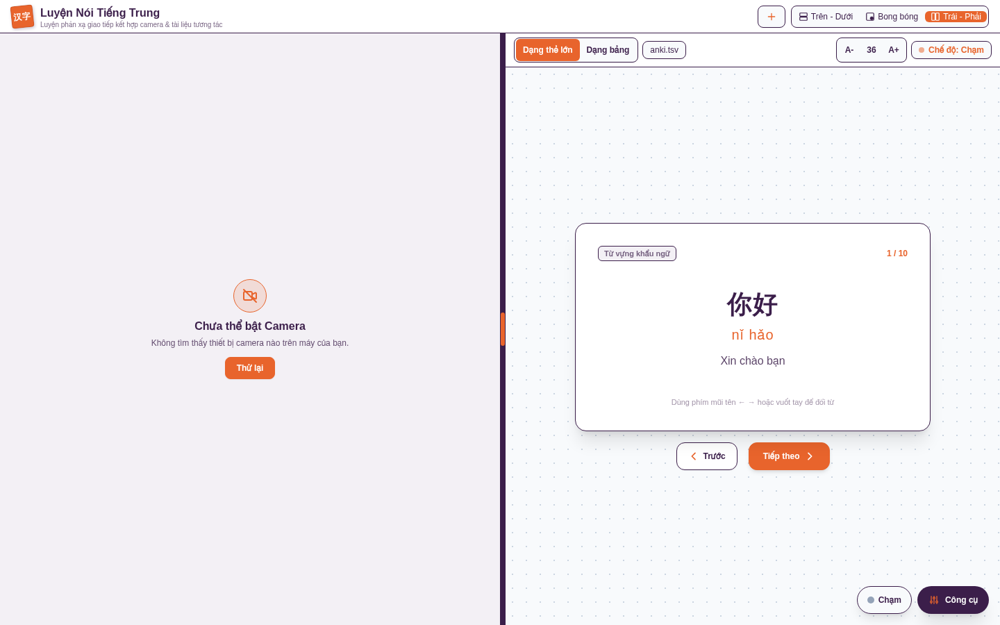
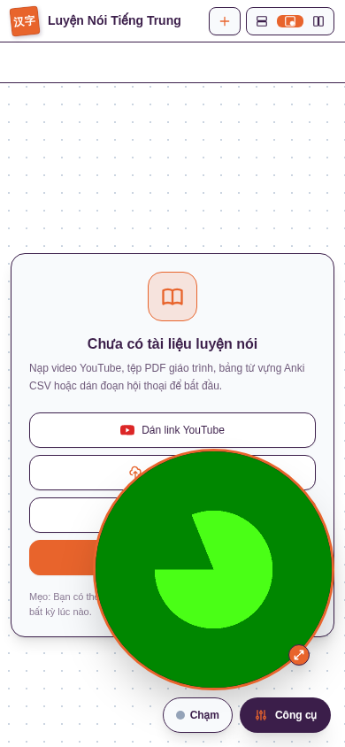
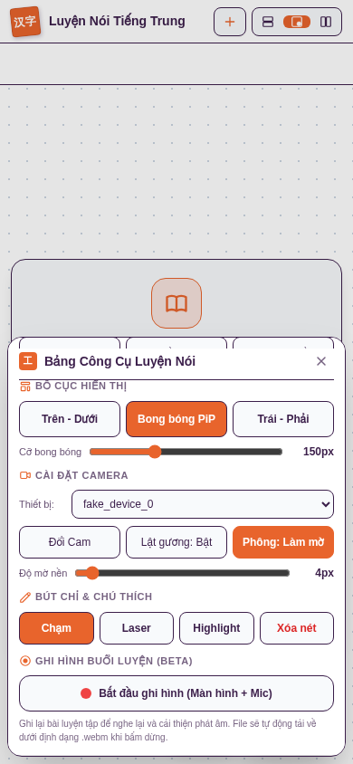
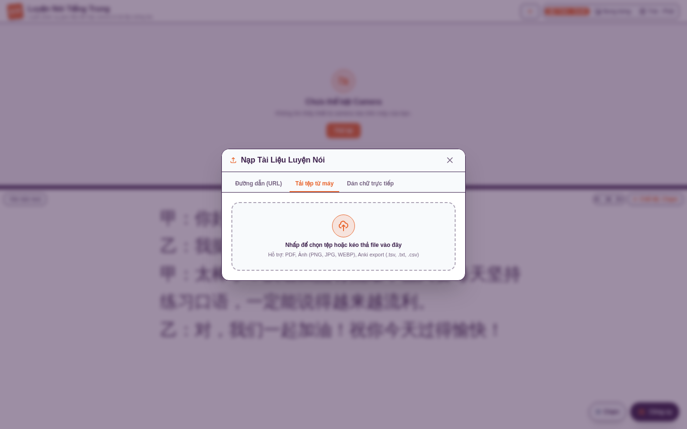
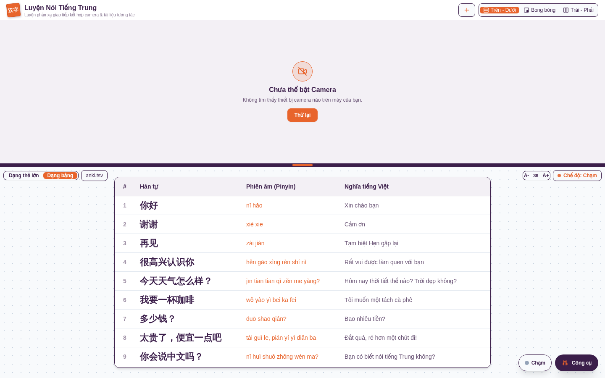
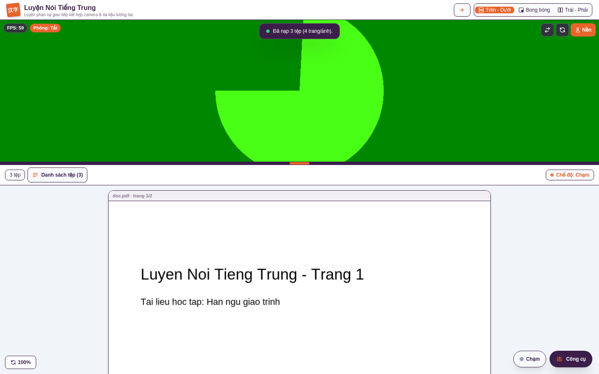
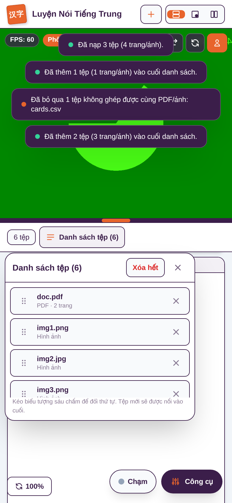
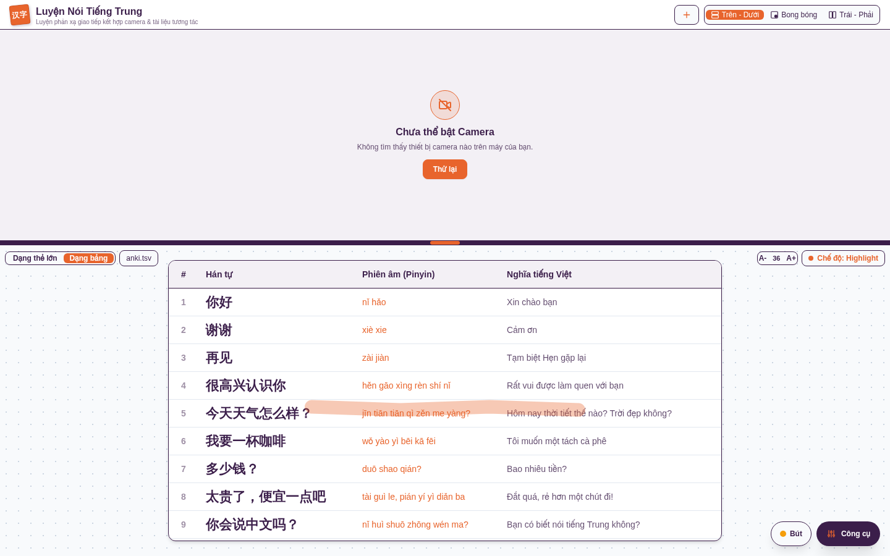

# 汉字 Luyện Nói Tiếng Trung

Web app luyện nói tiếng Trung: vừa quay mặt/khẩu hình của mình bằng camera, vừa xem tài liệu học (YouTube, PDF, ảnh, thẻ Anki, văn bản) trên cùng một màn hình. Dùng tốt trên điện thoại lẫn máy tính.

**Dùng thử:** https://luyennoi.sctuts.com

Toàn bộ app là **một file `index.html`** duy nhất, không cần build, không có backend. Mọi xử lý (camera, tách nền AI, đọc PDF/CSV) đều chạy ngay trên trình duyệt — tài liệu và hình ảnh của bạn không bị gửi đi đâu.



---

## Tính năng

### 1. Ba kiểu bố cục

- **Trên - Dưới** (mặc định): camera ở trên, tài liệu ở dưới. Kéo thanh chia ở giữa để đổi tỉ lệ (15% – 85%).
- **Bong bóng PiP**: tài liệu chiếm toàn màn hình, camera thu thành bong bóng tròn kéo đi đâu cũng được.
- **Trái - Phải**: hợp với màn hình rộng trên máy tính.

| Bong bóng PiP | Trái - Phải |
|---|---|
|  |  |

### 2. Đổi cỡ bong bóng camera

Ở chế độ bong bóng, chỉnh cỡ bằng một trong các cách:

- Kéo nút tròn cam ở góc dưới-phải bong bóng
- Chụm / mở hai ngón tay trên bong bóng
- Lăn chuột trên bong bóng (máy tính)
- Thanh **Cỡ bong bóng** trong bảng Công cụ

Cỡ từ 90px đến 360px, bong bóng luôn nằm trong màn hình, và app nhớ cỡ đã chọn cho lần sau.



### 3. Camera và tách nền AI

- Đổi camera trước / sau trên điện thoại, chọn webcam trên máy tính.
- **Lật gương** (bật sẵn với camera trước).
- **Xóa phông** bằng AI (MediaPipe, chạy ngay trên máy): Tắt → **Làm mờ nền** → **Nền trơn**.
- Thanh **Độ mờ nền** (2 – 40) để chỉnh mức mờ khi đang ở chế độ Làm mờ.
- Máy yếu không kịp xử lý thì app tự chuyển về video gốc cho mượt.



### 4. Nạp tài liệu học

Bấm nút **+** hoặc kéo-thả file thẳng vào trang:

- **YouTube**: dán link `youtube.com/watch?v=…`, `youtu.be/…` hoặc `youtube.com/shorts/…`.
- **PDF**: hiển thị tất cả các trang, nét trên màn hình điện thoại.
- **Ảnh** (JPG, PNG, WebP).
- **Thẻ Anki** (`.csv`, `.tsv`, `.txt`): tự nhận dấu phân cách (phẩy, chấm phẩy, tab), tự lọc thẻ HTML và `[sound:…]`.
- **Dán chữ trực tiếp**: dán đoạn hội thoại hoặc danh sách từ, chỉnh cỡ chữ A- / A+ (20 – 56px) để chỉ tay cho dễ.



### 5. Thẻ từ vựng Anki: dạng thẻ lớn và dạng bảng

Chữ Hán to, pinyin và nghĩa tiếng Việt ở dưới. Chuyển giữa **Dạng thẻ lớn** (lật từng thẻ bằng nút, phím mũi tên hoặc vuốt) và **Dạng bảng** (xem cả danh sách).



### 6. Ghép nhiều file thành một tài liệu

- Chọn hoặc kéo-thả **nhiều PDF và ảnh cùng lúc**: tất cả được ghép thành một trang cuộn dọc theo đúng thứ tự file, PDF trải ra từng trang.
- Đang mở tài liệu mà thả thêm file thì file mới **nối vào cuối**.
- **Danh sách tệp**: kéo biểu tượng ⋮⋮ để đổi thứ tự, ✕ để bỏ một tệp, **Xóa hết** để làm lại.
- **Phóng to / thu nhỏ**: chụm hai ngón tay, Ctrl + lăn chuột, hoặc chạm/bấm đúp để chuyển giữa vừa khung và 2x (50% – 600%). Khi đã phóng to, kéo một ngón để di chuyển; trang PDF tự vẽ lại cho nét.

| Ghép PDF + ảnh | Danh sách tệp |
|---|---|
|  |  |

### 7. Chỉ tay laser và bút highlight

Lớp vẽ phủ lên tài liệu, có 3 chế độ:

- **Chạm**: thao tác bình thường với nội dung (bấm play YouTube, cuộn PDF, phóng ảnh).
- **Laser**: chấm đỏ cam phát sáng kèm vệt mờ dần, để chỉ vào từng chữ khi đọc.
- **Highlight**: bút dạ quang giữ nguyên trên màn hình để đánh dấu thanh điệu, từ khó. Bấm **Xóa nét** để xóa.



### 8. Ghi hình buổi luyện (Beta)

Ghi lại màn hình + micro rồi tải file `.webm` về để tự nghe lại phát âm. Trên Chrome máy tính, app gợi ý sẵn tab hiện tại. iPhone / Safari không hỗ trợ ghi trong trình duyệt — dùng tính năng quay màn hình có sẵn của điện thoại.

---

## Chạy trên máy

Camera chỉ hoạt động trên `https://` hoặc `http://localhost`, nên cần chạy qua một server tĩnh bất kỳ:

```bash
git clone https://github.com/cuongdcdev/luyen-noi.git
cd luyen-noi
python3 -m http.server 8000
# mở http://localhost:8000
```

Thư mục `samples/` có sẵn vài file để thử (thẻ Anki `.tsv`, `.csv`, một PDF và một ảnh).

## Tự host

Copy `index.html` lên bất kỳ host tĩnh nào có HTTPS. Nếu server đặt header `Content-Security-Policy`, cần cho phép `'wasm-unsafe-eval'` (và `'unsafe-eval'`) để phần tách nền AI chạy được.

## Công nghệ

Một file HTML, thư viện tải qua CDN (đã khóa phiên bản):

- [Tailwind CSS](https://tailwindcss.com) 3.4.17
- [PDF.js](https://mozilla.github.io/pdf.js/) 3.11.174
- [PapaParse](https://www.papaparse.com) 5.4.1
- [MediaPipe Selfie Segmentation](https://github.com/google-ai-edge/mediapipe) 0.1.1675465747
